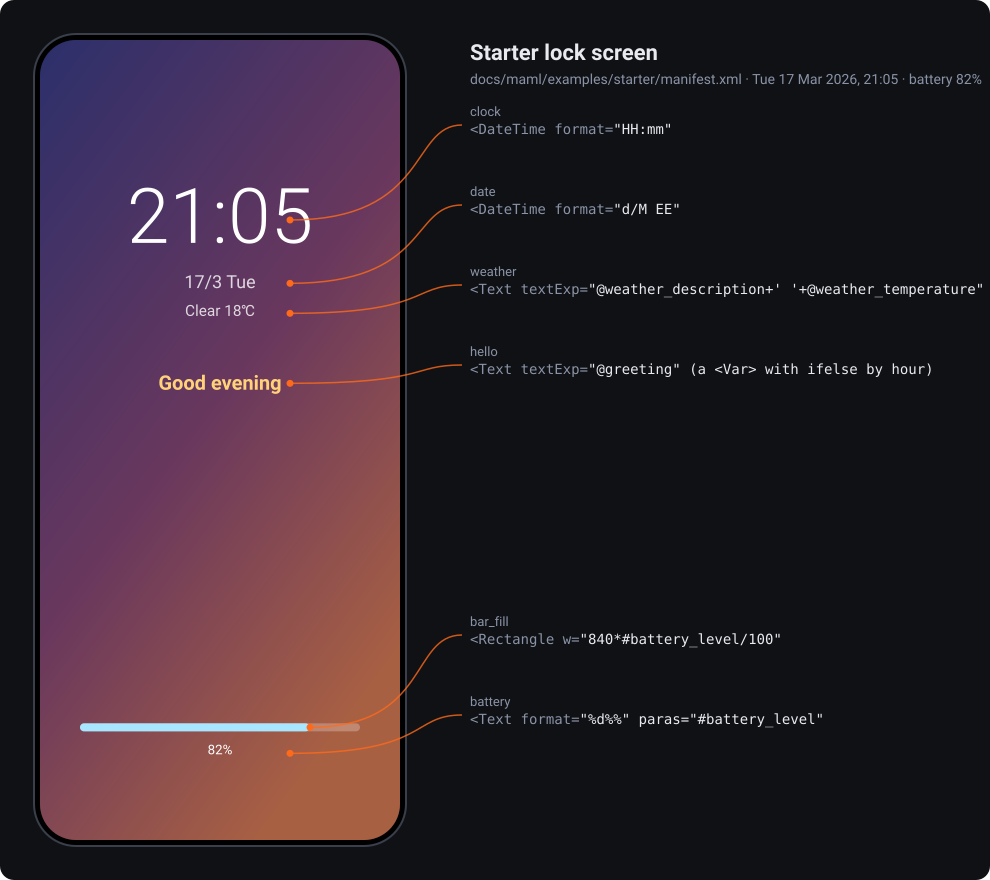

# Lock screen & widget guide (MAML)

Xiaomi lock screens, clocks and many widgets are written in **MAML**, an XML layout language. Every element is a piece on the screen (`<Text>`, `<DateTime>`, `<Image>`, `<Rectangle>`…), and almost any attribute can be a **formula** that the phone works out again whenever the time, the battery or the weather changes.

This guide shows how to build and edit those layouts in Mi Theme Studio. Every example comes with what it shows on the screen.

## Contents

| Page | What's in it |
| --- | --- |
| [Using the editor](editor.md) | Opening a lock screen, selecting and moving pieces, the side panel, adding widgets, copying from other themes |
| [Text, dates and times](text-and-dates.md) | `text`, `textExp`, `format` + `paras`, and every `DateTime` pattern (`HH:mm`, `d/M EE`, …) |
| [Formulas](expressions.md) | `#numbers` and `@strings`, joining text, operators (and why `<` is written `{`), every function |
| [Variables](variables.md) | What the phone provides (`#hour24`, `#battery_level`…), weather and step binders, your own `<Var>`s, theme settings |
| [Position, size and style](layout.md) | `x`/`y` and alignment, colours (`#AARRGGBB`), opacity, rotation, rings and bars, showing and hiding |
| [Recipes](recipes.md) | Copy-paste solutions: greeting, weather line, battery bar, charging ring, unread badge, day/night pictures… |
| [Troubleshooting](troubleshooting.md) | When something shows `0`, is blank, or looks different on the phone |

A complete, working layout to start from is in [examples/starter/manifest.xml](examples/starter/manifest.xml).

## Cheat sheet

| I want to show… | Write |
| --- | --- |
| The time, 24-hour | `<DateTime format="HH:mm"/>` → `21:05` |
| Day/month and weekday | `<DateTime format="d/M EE"/>` → `17/3 Tue` |
| Weather description and temperature | `<Text textExp="@weather_description+' '+@weather_temperature"/>` → `Clear 18℃` |
| Battery percent | `<Text format="%d%%" paras="#battery_level"/>` → `82%` |
| Something only while charging | `visibility="eq(#battery_state,1)"` |
| A bar as long as the battery | `w="520*#battery_level/100"` |
| A different text by time of day | `textExp="ifelse(#hour24{12,'Good morning','Good evening')"` |

The three rules people trip over most:

1. **`#` reads a number, `@` reads text.** `#battery_level`, `@weather_city`.
2. **Text in a formula goes in single quotes.** `@weather_description+' '+@weather_temperature`. The quotes around the whole attribute are double.
3. **XML can't hold `<`, `>` or `&&` in an attribute.** MAML writes `<` as `{`, `>` as `}` and `&&` as `**`: `#hour24{12`, `#battery_level}=20`, `#a**#b`.

## How the examples were made

All the example results and pictures in this guide come from the editor's own preview engine, at **Tuesday 17 March 2026, 21:05:07**, battery 82%, weather *Clear, 18℃*, on a 1080 × 2400 screen. A test (`src/lib/mamlDocExamples.test.ts`) checks every result printed here and redraws the pictures, so the guide and the editor can't disagree.

The preview is an approximation of the phone's own renderer. Where they differ, the page says so; see also [Troubleshooting](troubleshooting.md#the-preview-and-the-phone-disagree).
