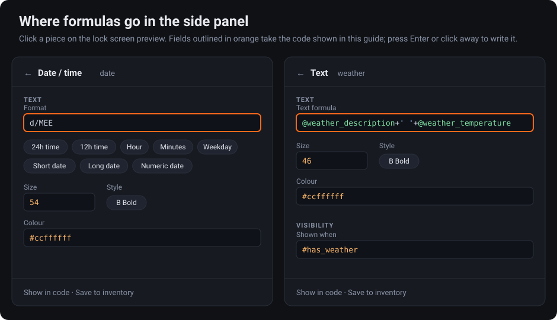

# Using the editor

[← Guide](README.md)

## Open a lock screen

1. Open a theme (`.mtz`) or start a new one.
2. On the **Design** board, open the **Lock screen** card (clocks and widgets with a `manifest.xml` work the same way).
3. Pick the **Preview** tab at the top. **Files** shows the raw files instead.

If the card says *Nothing to draw yet*, the part has no `manifest.xml`. Use **Swap from another theme…** to take a whole lock screen from another theme, or add the files yourself (a starter is in [examples/starter/manifest.xml](examples/starter/manifest.xml)).

### The toolbar

| Control | What it does |
| --- | --- |
| **Layout** list | When a part has more than one `manifest.xml` (for example `advance/manifest.xml`), pick the one to edit. |
| **Page** buttons | Lock screens with several pages (swipe or tap to switch on the phone) show one button per page. |
| **Inventory** | Pieces you saved from any theme, plus working built-in widgets (battery, weather, steps, charging). Click one to add it. |
| **Open theme beside…** | Opens another theme next to yours. Right-click its pieces to copy them over, code and pictures included. |
| **Charging** | Draws the screen as if the phone were charging (`#battery_state = 1`), to check charging-only pieces. |
| **Play animations** | Runs the layout's animations. Stop them to edit the resting pose. |

A yellow badge such as *Video not drawn here* lists elements the phone draws but the preview can't.

## Select, move, resize

- **Click** a piece to select it. Pieces under other pieces can be picked from the **Pieces** list in the side panel.
- **Drag** to move. It snaps to the screen centre, edges and other pieces; hold **Alt** to skip snapping.
- **Arrow keys** nudge by 1 px, **Shift+arrows** by 10 px.
- **Corner handles** resize; the **round handle** rotates.
- **Shift+click** adds or removes pieces from the selection; **drag on an empty spot** selects everything in the box. Several pieces move together.
- **Esc** clears the selection.
- **Right-click** to copy, paste, or *Save to inventory*.

Every change is written straight into `manifest.xml`, keeping your comments, indentation and attribute order, and can be undone with **Ctrl+Z**.

When a position is a formula (for example `x="#screen_width/2"`), dragging keeps the formula and adds or subtracts a number (`#screen_width/2+40`) so it still adapts to every screen.

## The side panel

What you see depends on the kind of piece:

| Section | Fields | Writes |
| --- | --- | --- |
| **Text** (DateTime) | **Format**, with a picker of patterns and what each shows right now | `format` |
| **Text** (Text with a formula) | **Text formula** | `textExp` |
| **Text** (plain Text) | **Text**, and **Make it a formula** | `text` (or `format`), `textExp` |
| | **Size**, **Bold**, **Colour**, **Colour opacity** | `size`, `bold`, `color` |
| **Fill** (Rectangle, Circle, Ellipse) | Colour, **Corner radius** | `fillColor`, `cornerRadius` |
| **Arc** | Colour, **Line width**, **Start °**, **Sweep °** | `strokeColor`, `weight`, `startAngle`, `sweep` |
| **Position & size** | **X**, **Y**, **Width**, **Height** (or **Radius**), **Rotation °**, **Straighten**, and *X/Y is the left / centre / right · top / middle / bottom* | `x`, `y`, `w`, `h`, `r`, `rotation`, `align`, `alignV` |
| **Visibility** | **Opacity** slider (or **Opacity formula (0–255)**), **Hide it**, **Show only when…** (or **Shown when** for a formula) | `alpha`, `visibility` |
| **All settings** | Every attribute of the piece, each editable, plus an **Add** box | anything |

Tips:

- **Type a formula in any number field.** Write `#screen_width/2` in X and the label shows what it works out to now, for example **X = 540**.
- **Drag a number label left or right** to scrub its value (Shift: ×10), or use ↑/↓ in the field.
- **Press Enter or click away** to write a field. An empty field removes the attribute.
- **Colour** takes `#AARRGGBB` (see [colours](layout.md#colours)). A formula in a colour shows as **Colour formula**.
- **Show in code** jumps to the element in the XML editor; **Select its group** selects the `<Group>` it sits in.
- For a **picture that changes** (`srcExp`, such as `week_0.png … week_6.png`), the panel shows every version; click one to replace it.

### Formula fields

**Text formula**, **Shown when**, **Opacity formula** and a date's **Format** help you while you type:

- **Autocomplete.** Type `@` or `#` and every variable this layout has appears (the phone's, the weather and other data sources, the theme's own `<Var>`s and settings), each with what it holds right now. Typing `@` puts text variables first, `#` numbers. ↑/↓ to choose, **Enter** or **Tab** to insert, **Ctrl+Space** to open the list. Typing a function name (`ife…`) suggests `ifelse(` and the others.
- **Shows now** works the formula out as you type, as the phone would show it at this moment.
- **Hints** appear under the field for common mistakes: `<` or `>` instead of `{` `}`, `&&` instead of `**`, double quotes, an unclosed quote or bracket, a variable that doesn't exist, text read with `#`.
- **Snippets** (top right of the field) lists ready-made formulas with what each would show; **Insert** writes one in. For a date, **Patterns** lists date patterns with today's result.
- **Try** opens the formula in the Guide's Try it page, to see it at other times, battery levels and weather.
- **Enter** or clicking away writes the change; **Esc** puts the old value back.

### Turn a plain text into a formula

Select the text and click **Make it a formula** under the Text field. Its words become a formula (`'Swipe up'`), and the field turns into **Text formula** with autocomplete, ready for, for example, `@weather_description+' '+@weather_temperature`.

To show or hide a piece by a condition, click **Show only when…** in Visibility; it starts as `eq(#battery_state,1)` (while charging) and **Snippets** has others.

Any other attribute can be added in **All settings → Add**, for example `format="%d%%"` with `paras="#battery_level"`.

### Change a date format

Select the date, then click a chip or type a pattern in **Format**, for example `d/M EE` → `17/3 Tue`. All the letters are in [Text, dates and times](text-and-dates.md#date-and-time-patterns).

## Add working widgets

The **Guide** tab opens on **Widgets**: a gallery of working lock screen widgets (date line, big clock, weather line, greeting, battery bar and ring, low battery warning, unread messages, next alarm, weather and step cards). Each one is drawn live by the preview engine; **Preview as** changes the time, battery, charging, weather, messages and alarm it is drawn with. Pick one, adjust it with plain controls (order, weekday, size, colour, words…), and **Add to lock screen** opens your lock screen and adds it to the page you are editing, with any data source it needs. **Copy code** copies what it writes.

**Inventory → Built-in widgets** in the lock screen editor has pieces that work on the phone, built only from shapes and text so you can restyle every part:

| Widget | Reads | Notes |
| --- | --- | --- |
| **Battery bar** | `#battery_level` | Bar width `520*#battery_level/100`, text `%d%%`. |
| **Weather** | the Weather app | Adds a weather binder (`mts_weather`) once; shows `@mts_weather_city`, `%d°` of `#mts_weather_temp`, `@mts_weather_desc+'  '+@mts_weather_range`. |
| **Step count** | Mi Fitness / Mi Health | Adds a step binder (`mts_steps`). Needs the app on the phone. |
| **Charging ring** | `#battery_level`, `#battery_state` | Only visible while charging. |

Each one is added to the page you are editing, from about 30% down the screen and below widgets added before, ready to move. On a multi-page lock screen it is set to show only on that page.

## Reuse pieces from any theme

- **Right-click → Save to inventory** keeps a piece (or a selection) with its code, pictures and data source, so it works when added to another theme.
- **Open theme beside…** shows a downloaded or other theme next to yours; right-click its pieces → **Copy over to … of my theme**. Pictures come along; if a file with the same name but different content is already in your theme, the copied pictures go into a folder of their own, and clashing names in the code are renamed.
- **Ctrl+C / Ctrl+V** work between the two.

## Edit the code directly

**Show in code**, or the **Files** tab → `manifest.xml`, opens the XML editor with live well-formedness checks. The preview follows when you save. Everything in this guide can be typed there too.

Next: [Text, dates and times →](text-and-dates.md)
