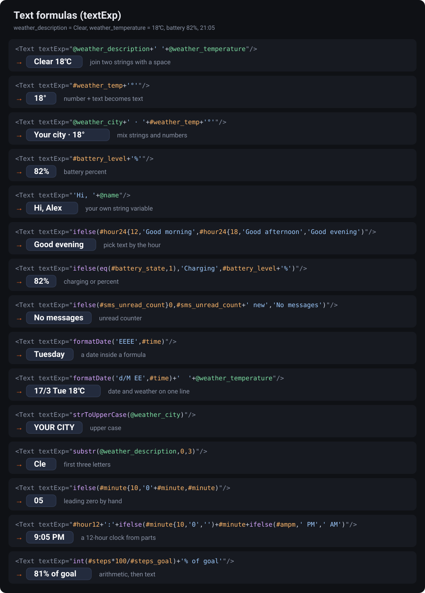

# Formulas

[← Guide](README.md)

Almost every attribute in MAML can be a formula: a text's words (`textExp`), a position (`x="#screen_width/2"`), a size, an opacity, a colour, whether a piece is shown (`visibility`). The phone works formulas out again whenever what they read changes.



## Values

| Write | Is | Example |
| --- | --- | --- |
| `#name` | a variable, read as a **number** | `#battery_level` → 82 |
| `@name` | a variable, read as **text** | `@weather_city` → Your city |
| `'words'` | text | `' · '` |
| `42`, `0.5` | a number | |
| `#name.field` | a property of a named piece or binder | `#clock.bmp_width`, `#unlocker.move_y` |
| `@name[2]` | one item of a list variable | `@forecast_high[1]`: tomorrow's high |

Which variables exist is on the [Variables](variables.md) page. A variable that doesn't exist reads as `0` (`#…`) or empty text (`@…`).

Use `#` when you calculate and `@` when you show words. Reading a text variable with `#` turns it into a number (`'18'` → 18). Reading a number with `@` gives its digits.

## Joining text

`+` joins when either side is text, and adds when both are numbers:

| textExp | Shows | |
| --- | --- | --- |
| `@weather_description+' '+@weather_temperature` | Clear 18℃ | join two strings with a space |
| `#weather_temp+'°'` | 18° | number + text becomes text |
| `@weather_city+' · '+#weather_temp+'°'` | Your city · 18° | mix strings and numbers |
| `#battery_level+'%'` | 82% | battery percent |
| `'Hi, '+@name` | Hi, Alex | your own string variable |
| `int(#steps*100/#steps_goal)+'% of goal'` | 81% of goal | arithmetic, then text |

Formulas are read left to right, so `1+2+'x'` is `3x` but `'x'+1+2` is `x12`. Put arithmetic in brackets when you join it to text: `'Total: '+(#a+#b)`.

In the example lock screen, `@weather_temperature` is declared as text (`type="string"`), so it comes with its own `℃`. Declared as `type="int"` it would be the bare number `18`, and you would add your own sign: `#weather_temp+'°'`.

## Choosing: ifelse

`ifelse(condition, then, otherwise)` picks one of two values. A condition is true when it is more than 0.

```
ifelse(#battery_level{20, 'Low battery', 'OK')
```

Chain more pairs for more choices; the first true condition wins and the last value is the fallback:

```
ifelse(#hour24{12,'Good morning', #hour24{18,'Good afternoon', 'Good evening')
```

| textExp | Shows | |
| --- | --- | --- |
| `ifelse(#hour24{12,'Good morning',#hour24{18,'Good afternoon','Good evening')` | Good evening | pick text by the hour |
| `ifelse(eq(#battery_state,1),'Charging',#battery_level+'%')` | 82% | charging or percent |
| `ifelse(#sms_unread_count}0,#sms_unread_count+' new','No messages')` | No messages | unread counter |

`ifelse` works in any number attribute too: `size="ifelse(len(@weather_city)}10,40,56)"`, `alpha="ifelse(#hour24}=20,150,255)"`. For colours, see [colour formulas](layout.md#colour-formulas).

## Operators

An XML attribute can't contain `<`, and `&` has to be escaped, so MAML uses other symbols:

| Meaning | MAML | Example |
| --- | --- | --- |
| less than | `{` | `#hour24{12` |
| less than or equal | `{=` | `#battery_level{=20` |
| greater than | `}` | `#sms_unread_count}0` |
| greater than or equal | `}=` | `#hour24}=18` |
| equal | `==` (or `eq(a,b)`) | `#battery_state==1` |
| not equal | `!=` (or `ne(a,b)`) | `#battery_state!=0` |
| and | `**` | `#hour24}=6**#hour24{18` |
| or | `&#124;&#124;` | `#hour24{6&#124;&#124;#hour24}=18` |
| not | `!` (or `not(x)`) | `!#music_state` |
| add / join, subtract | `+` `-` | `#screen_width-100` |
| multiply, divide, remainder | `*` `/` `%` | `#second*6`, `#minute%10` |
| grouping | `( )` | `(#a+#b)/2` |

Comparisons give `1` (true) or `0` (false), so they can be used as numbers: `alpha="255*(#hour24}=18)"` is 255 in the evening and 0 otherwise.

Order: `!` and minus sign first, then `* / %`, then `+ -`, then comparisons, then `**`, then `||`. When in doubt, add brackets.

In the code editor you can also write `&lt;` and `&gt;`, but `{` and `}` are what themes use and what stays readable.

## Functions

These are the functions the editor's preview understands. The phone has the same ones and a few more; the preview treats a function it doesn't know as `0`.

### Numbers

| Function | Result | Example → result |
| --- | --- | --- |
| `int(x)` | whole part | `int(81.65)` → 81 |
| `round(x)` | nearest whole number | `round(2.5)` → 3 |
| `floor(x)`, `ceil(x)` | round down / up | `ceil(4.1)` → 5 |
| `abs(x)` | without sign | `abs(-3)` → 3 |
| `min(a,b,…)`, `max(a,b,…)` | smallest / largest | `min(#steps/#steps_goal,1)` caps a bar at full |
| `pow(x,y)`, `sqrt(x)` | power, square root | |
| `sin(x)`, `cos(x)`, `tan(x)` | trigonometry, `x` in radians | `cos(#second*6*3.14159/180)` |
| `rand()` | random 0–1 (the preview always uses 0.5) | |
| `digit(n, i)` | the i-th digit of `n` from the right (1 = ones); -1 when `n` is shorter | `digit(#hour24,2)` → 2, `digit(#minute,2)` → -1 (use `int(#minute/10)` → 0) |

### Conditions

| Function | Result |
| --- | --- |
| `ifelse(c1,v1, c2,v2, …, else)` | first value whose condition is > 0 |
| `eq(a,b)`, `ne(a,b)` | 1 if equal / not equal |
| `gt(a,b)`, `ge(a,b)`, `lt(a,b)`, `le(a,b)` | `>`, `>=`, `<`, `<=` without the symbols |
| `not(x)` | 1 if `x` is 0 |
| `isnull(x)` | 1 if `x` is empty or 0 |

### Text

| Function | Result | Example → result |
| --- | --- | --- |
| `len(s)` | number of characters | `len(@weather_city)` → 9 |
| `substr(s, start, count)` | part of a text (start at 0) | `substr(@weather_description,0,3)` → Cle |
| `strToUpperCase(s)`, `strToLowerCase(s)` | change case | `strToUpperCase(@weather_city)` → YOUR CITY |
| `strTrim(s)` | without spaces at the ends | |
| `strContains(s, part)` | 1 if `part` is in `s` | `strContains(@weather_description,'Rain')` |
| `strIsEmpty(s)` | 1 if empty | `visibility="!strIsEmpty(@next_alarm_time)"` |
| `formatDate(pattern, time)` | a date as text | `formatDate('EEEE',#time)` → Tuesday |

## Where formulas go

| Attribute | Expects | Example |
| --- | --- | --- |
| `textExp` | text | `@weather_description+' '+@weather_temperature` |
| `paras` | comma-separated formulas | `#hour24,#minute` |
| `formatExp` | a pattern / template as text | `ifelse(#time_format,'HH:mm','h:mm')` |
| `x`, `y`, `w`, `h`, `size`, `rotation`, `alpha`, `sweep`… | a number | `#screen_width/2` |
| `visibility` | a number: shown when > 0 | `eq(#battery_state,1)` |
| `color`, `fillColor`, `strokeColor` | `#AARRGGBB`, `@var` holding one, or `argb(a,r,g,b)` | see [colour formulas](layout.md#colour-formulas) |
| `srcExp` | a picture's file name | `'weather_'+#weather_type+'.png'` |
| `<Var expression="…">` | a value kept under a name | see [your own variables](variables.md#your-own-variables) |

Number attributes in formula form are covered with pictures in [Position, size and style](layout.md).

Next: [Variables →](variables.md)
