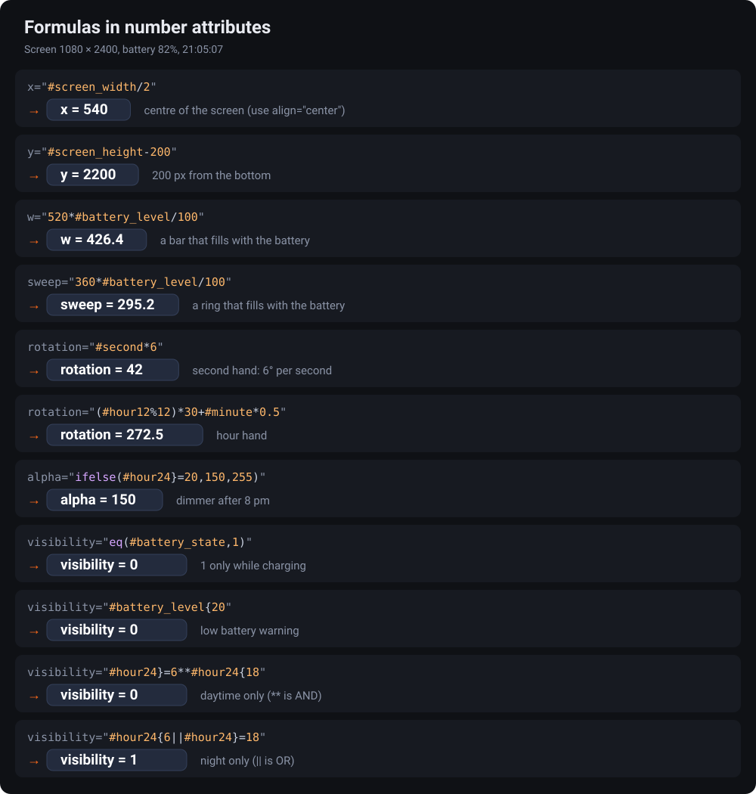
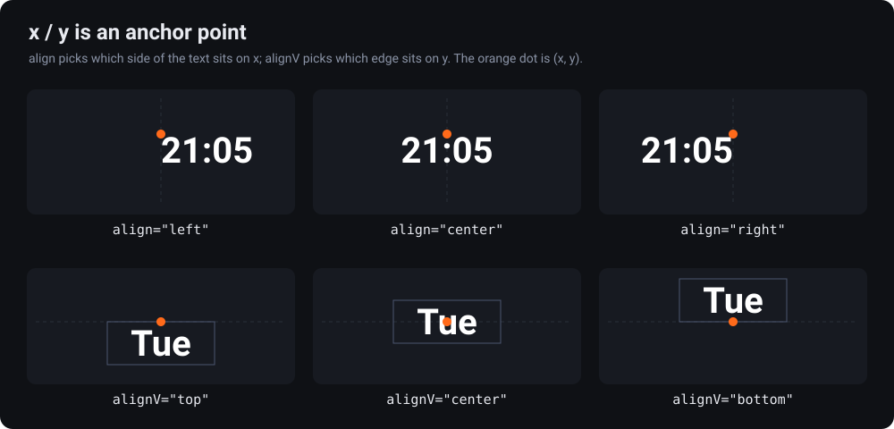
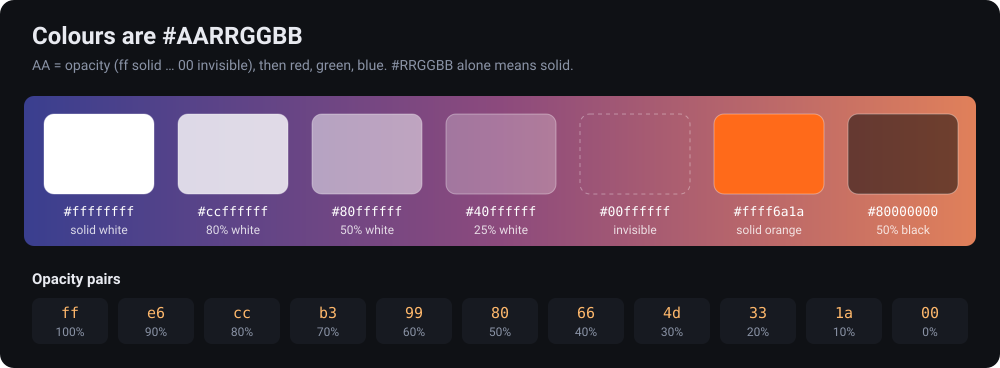
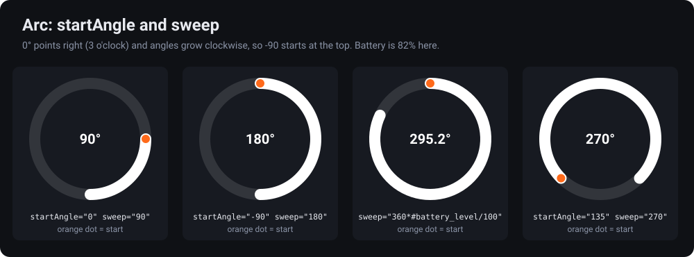

# Position, size and style

[← Guide](README.md)

## The screen

- Layouts are designed for a screen **1080 px wide** (`screenWidth="1080"` on `<Lockscreen>`); the phone scales them to its own width. The height follows the phone, so lay out from the top and bottom with `#screen_height`.
- `x="0" y="0"` is the **top-left corner**; `x` grows to the right, `y` grows down.
- Pieces are drawn **in the order they're written**: later pieces cover earlier ones. Put the background first.
- Inside a `<Group x="…" y="…">`, children's `x`/`y` are measured from the group's corner, and the group's `alpha`, `visibility` and `rotation` apply to everything in it.

## Formulas in numbers

Any number can be a formula. Use them to adapt to the screen and to follow the phone:



| Attribute | Formula | Is | |
| --- | --- | --- | --- |
| `x` | `#screen_width/2` | 540 | centre of the screen (use align="center") |
| `y` | `#screen_height-200` | 2200 | 200 px from the bottom |
| `w` | `520*#battery_level/100` | 426.4 | a bar that fills with the battery |
| `sweep` | `360*#battery_level/100` | 295.2 | a ring that fills with the battery |
| `rotation` | `#second*6` | 42 | second hand: 6° per second |
| `rotation` | `(#hour12%12)*30+#minute*0.5` | 272.5 | hour hand |
| `alpha` | `ifelse(#hour24}=20,150,255)` | 150 | dimmer after 8 pm |
| `visibility` | `eq(#battery_state,1)` | 0 | 1 only while charging |
| `visibility` | `#battery_level{20` | 0 | low battery warning |
| `visibility` | `#hour24}=6**#hour24{18` | 0 | daytime only (** is AND) |
| `visibility` | `#hour24{6&#124;&#124;#hour24}=18` | 1 | night only (&#124;&#124; is OR) |

In the editor's side panel, a number field holding a formula shows its current value next to the label (**X = 540**). Dragging a piece whose position is a formula keeps the formula and adds the distance (`#screen_width/2+40`).

## x, y and alignment

`x`/`y` is an **anchor point**. `align` (`left`, `center`, `right`) says which side of the piece sits on `x`; `alignV` (`top`, `center`, `bottom`) says which edge sits on `y`. The default is the top-left corner.



To centre anything horizontally on every phone:

```xml
<DateTime x="#screen_width/2" align="center" y="420" size="230" format="HH:mm"/>
```

To stick something to the bottom:

```xml
<Text x="#screen_width/2" align="center" y="#screen_height-120" alignV="bottom" text="Swipe up to unlock"/>
```

In the side panel these are the **X/Y is the left / centre / right** and **top / middle / bottom** buttons. They keep `x`/`y` and change which point sits there, so the piece moves on the screen; drag it back if needed. A `<Circle>`'s `x`/`y` is always its centre.

## Size

| Attribute | For |
| --- | --- |
| `w`, `h` (or `width`, `height`) | Pictures, shapes, videos, wrapping text. A picture without them uses the file's own size. |
| `r` | Circle radius. |
| `size` | Text font size. |
| `scale`, `scaleX`, `scaleY` | Grow or shrink (1 = as is), around `pivotX`/`pivotY`. |

Width can follow a value to make bars:

```xml
<Rectangle x="120" y="2050" w="840" h="24" cornerRadius="12" fillColor="#40ffffff"/>
<Rectangle x="120" y="2050" w="840*#battery_level/100" h="24" cornerRadius="12" fillColor="#ffa8e6ff"/>
```

To cap a bar at full: `w="368*min(#steps/max(#steps_goal,1),1)"` (`max(…,1)` avoids dividing by 0 before the data arrives).

## Colours



Colours are written `#AARRGGBB`: the first pair is **opacity**, then red, green and blue, all in hex (`00`–`ff`). `#RRGGBB` is solid. In the side panel, **Colour** has a picker and a separate **Colour opacity** slider that writes the first pair for you.

| Attribute | On |
| --- | --- |
| `color` | Text, DateTime |
| `fillColor` | Rectangle, Circle, Ellipse, Arc (pie) |
| `strokeColor` + `weight` | outlines, Arc rings, Line |

### Colour formulas

On the phone a colour can also come from a formula, in two ways:

```xml
<!-- a string variable that holds a colour -->
<Var name="accent" type="string" expression="ifelse(#battery_level{20,'#ffff4040','#ffffffff')"/>
<Text color="@accent" .../>

<!-- argb(alpha, red, green, blue), each 0–255 and each can be a formula -->
<Rectangle fillColor="argb(255, 255, 255*#battery_level/100, 64)" .../>
```

The editor's preview draws only fixed colours; a colour formula is drawn white. When the colour matters in the preview too, use two pieces and switch them with `visibility`:

```xml
<Text color="#ffff4040" visibility="#battery_level{20" .../>
<Text color="#ffffffff" visibility="#battery_level}=20" .../>
```

## Opacity

`alpha` goes from `0` (invisible) to `255` (solid) and applies to the whole piece, on top of the colour's own opacity. In the side panel it's the **Opacity** slider, or **Opacity formula (0–255)** when it's a formula.

```xml
<Image src="glow.png" alpha="ifelse(#hour24}=20,150,255)"/>
<Rectangle fillColor="#ff000000" alpha="255*(#hour24{6||#hour24}=22)"/>  <!-- dark at night -->
```

## Showing and hiding

`visibility` shows a piece when it's more than 0:

| visibility | Shown |
| --- | --- |
| `false` | never (what **Hide it** writes) |
| `eq(#battery_state,1)` | while charging |
| `eq(#battery_state,1)+eq(#battery_state,3)` | while charging or full (adding = or) |
| `#battery_level{20` | battery under 20% |
| `#has_weather` | once weather data has arrived |
| `#sms_unread_count}0` | when there are unread messages |
| `#hour24{6&#124;&#124;#hour24}=18` | at night |

A hidden piece doesn't take touches. Use the toolbar's **Charging** button to see charging-only pieces in the editor.

## Rotation

`rotation` (or `angle`) is in degrees, clockwise, around `pivotX`/`pivotY` (measured from the piece's top-left; the top-left corner itself when not given). For clock hands, set the pivot to the hand's centre of turning:

```xml
<Image src="hand_second.png" x="540" y="900" pivotX="10" pivotY="300" rotation="#second*6"/>
<Image src="hand_minute.png" x="540" y="900" pivotX="12" pivotY="280" rotation="#minute*6+#second*0.1"/>
<Image src="hand_hour.png"   x="540" y="900" pivotX="14" pivotY="200" rotation="(#hour12%12)*30+#minute*0.5"/>
```

The round handle on a selected piece rotates it; **Straighten** removes the rotation.

## Shapes

| Element | Main attributes |
| --- | --- |
| `<Rectangle>` | `x y w h`, `fillColor`, `cornerRadius`, `strokeColor`, `weight` |
| `<Circle>` | `x y` (the centre), `r`, `fillColor`, `strokeColor`, `weight` |
| `<Ellipse>` | `x y w h`, `fillColor`, `strokeColor` |
| `<Arc>` | `x y w h`, `startAngle`, `sweep`, `strokeColor`, `weight`, `cap="round"`, `strokeAlign="inner"`, `close="true"` for a pie |
| `<Line>` | `x y` to `x1 y1`, `strokeColor`, `weight` |

### Arcs, rings and gauges



`startAngle` is where the arc begins: **0° points right** (3 o'clock), and angles grow **clockwise**, so `-90` starts at the top. `sweep` is how far it goes. A ring that fills with the battery:

```xml
<Arc x="280" y="1200" w="520" h="520" startAngle="-90" sweep="360"
     strokeColor="#33ffffff" weight="28" strokeAlign="inner"/>
<Arc x="280" y="1200" w="520" h="520" startAngle="-90" sweep="360*#battery_level/100"
     strokeColor="#ffffffff" weight="28" strokeAlign="inner" cap="round"/>
```

`strokeAlign="inner"` keeps the line inside `w`×`h`; `cap="round"` rounds its ends.

## Pictures

| Attribute | Meaning |
| --- | --- |
| `src="bg.png"` | a file next to `manifest.xml` (folders allowed: `img/bg.png`) |
| `srcExp="'week_'+(#day_of_week-1)+'.png'"` | the file name from a formula: a different picture by day, hour, weather… |
| `src="digit.png" srcid="#minute%10"` | adds `_N` to the name: `digit_5.png` |
| `w`, `h` | draw at this size instead of the file's |

`srcExp` pictures show every version in the side panel (`week_0.png` … `week_6.png`): click one to replace it.

## Digit-picture clocks

`<Time>` and `<ImageNumber>` draw numbers from one picture per digit. With `src="time.png"`, the files are `time_0.png` … `time_9.png`, plus `time_dot.png` for the `:` and `time_minus.png` for `-`.

```xml
<Time x="540" y="400" align="center" src="time.png" format="HH:mm" space="6"/>
<ImageNumber x="540" y="700" align="center" src="num.png" number="#battery_level"/>
```

To restyle them, replace the digit pictures; the side panel says so when you select one.

Next: [Recipes →](recipes.md)
