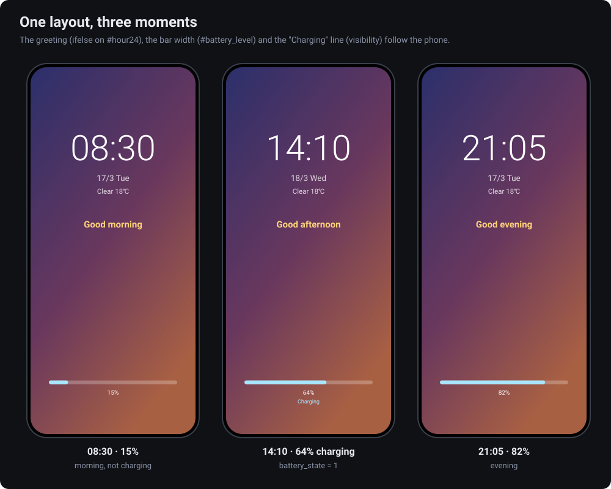

# Recipes

[← Guide](README.md)

Copy-paste solutions. Paste them into `manifest.xml` (**Show in code** or the **Files** tab), or add the attribute to an existing piece with **All settings → Add** in the side panel. Results are at 21:05 on Tuesday 17 March 2026, battery 82%, weather *Clear, 18℃*.



The three screens above are the [starter lock screen](examples/starter/manifest.xml), which uses most of these recipes.

---

### Date as day/month and weekday

```xml
<DateTime x="#screen_width/2" align="center" y="700" size="54" color="#ccffffff" format="d/M EE"/>
```

→ **17/3 Tue**. Other orders: `M/d EE` → 3/17 Tue, `EEE d MMM` → Tue 17 Mar, `EEEE, d MMMM` → Tuesday, 17 March. All letters: [date patterns](text-and-dates.md#every-letter).

### Weather on one line

Declare the weather binder once (see [Variables → Weather](variables.md#weather)), then:

```xml
<Text x="#screen_width/2" align="center" y="790" size="46" color="#ccffffff"
      textExp="@weather_description+' '+@weather_temperature" visibility="#has_weather"/>
```

→ **Clear 18℃**. Variations:

| textExp | Shows |
| --- | --- |
| `@weather_city+' · '+#weather_temp+'°'` | Your city · 18° |
| `formatDate('d/M EE',#time)+'  '+@weather_temperature` | 17/3 Tue  18℃ |

Shortcut: **Inventory → Weather** adds a ready-made weather card with its binder.

### Weather icon by condition

```xml
<Image x="540" y="880" align="center" w="120" h="120" srcExp="'weather/'+#weather_type+'.png'" visibility="#has_weather"/>
```

Make one picture per condition number (`weather/0.png`, `weather/1.png`, …).

### Greeting by time of day

```xml
<Var name="greeting" type="string"
     expression="ifelse(#hour24{12,'Good morning',#hour24{18,'Good afternoon','Good evening')"/>
<Text x="#screen_width/2" align="center" y="1000" size="60" bold="true" color="#ffffd27a" textExp="@greeting"/>
```

→ **Good evening**. Add a name: `textExp="@greeting+', '+@name"`.

### Battery percent

```xml
<Text x="#screen_width/2" align="center" y="2110" size="40" format="%d%%" paras="#battery_level"/>
```

→ **82%**. As a formula: `textExp="#battery_level+'%'"`.

### Battery bar

```xml
<Rectangle x="120" y="2050" w="840" h="24" cornerRadius="12" fillColor="#40ffffff"/>
<Rectangle x="120" y="2050" w="840*#battery_level/100" h="24" cornerRadius="12" fillColor="#ffa8e6ff"/>
```

The second bar is `840 × 82 / 100` = 688.8 px long. Shortcut: **Inventory → Battery bar**.

### "Charging" or the percent

```xml
<Text x="540" y="2110" align="center" size="40"
      textExp="ifelse(eq(#battery_state,1),'Charging',#battery_level+'%')"/>
```

→ **82%** (and *Charging* while plugged in). To show a separate line only while charging:

```xml
<Text x="540" y="2170" align="center" size="36" color="#ffa8e6ff" text="Charging" visibility="eq(#battery_state,1)"/>
```

Check it with the **Charging** button in the toolbar.

### Charging ring

```xml
<Group x="280" y="1100" w="520" h="520" visibility="eq(#battery_state,1)+eq(#battery_state,3)">
    <Arc x="0" y="0" w="520" h="520" startAngle="-90" sweep="360" strokeColor="#33ffffff" weight="28" strokeAlign="inner"/>
    <Arc x="0" y="0" w="520" h="520" startAngle="-90" sweep="360*#battery_level/100" strokeColor="#ffffffff" weight="28" strokeAlign="inner" cap="round"/>
    <Text x="260" y="260" align="center" alignV="center" size="120" bold="true" format="%d%%" paras="#battery_level"/>
</Group>
```

Shortcut: **Inventory → Charging ring**.

### Low battery warning in red

```xml
<Text x="540" y="2110" align="center" size="40" color="#ffff4040" format="%d%%" paras="#battery_level" visibility="#battery_level{20"/>
<Text x="540" y="2110" align="center" size="40" color="#ffffffff" format="%d%%" paras="#battery_level" visibility="#battery_level}=20"/>
```

Two pieces in the same place, each shown in its own case. (A [colour formula](layout.md#colour-formulas) also works on the phone but isn't drawn by the preview.)

### Unread messages badge

```xml
<Group visibility="#sms_unread_count}0">
    <Circle x="900" y="200" r="36" fillColor="#ffff4040"/>
    <Text x="900" y="200" align="center" alignV="center" size="36" bold="true" textExp="#sms_unread_count"/>
</Group>
<Text x="540" y="1200" align="center" size="36"
      textExp="ifelse(#sms_unread_count}0,#sms_unread_count+' new','No messages')"/>
```

→ **No messages** (the preview has nothing unread).

### Clock that follows the phone's 12/24-hour setting

```xml
<DateTime x="#screen_width/2" align="center" y="420" size="230" formatExp="ifelse(#time_format,'HH:mm','h:mm')"/>
<DateTime x="#screen_width/2" align="center" y="660" size="40" format="a" visibility="!#time_format"/>
```

### Big digits, one piece each

```xml
<Text x="300" y="400" size="300" format="%d" paras="int(#hour24/10)"/>
<Text x="480" y="400" size="300" format="%d" paras="#hour24%10"/>
<Text x="660" y="400" size="300" format="%d" paras="int(#minute/10)"/>
<Text x="840" y="400" size="300" format="%d" paras="#minute%10"/>
```

`int(n/10)` is the tens digit and `n%10` the ones. At 21:05 they show 2, 1, 0, 5. (`digit(n, 2)` gives the tens too, but -1 when `n` has only one digit, so it's not suited to minutes.) With pictures instead: `<Image src="big.png" srcid="#minute%10"/>` shows `big_5.png`.

### Day and night pictures

```xml
<Var name="night" expression="#hour24{6||#hour24}=18"/>
<Image src="sky_night.png" visibility="#night"/>
<Image src="sky_day.png" visibility="!#night"/>
```

Or one piece: `srcExp="ifelse(#night,'sky_night.png','sky_day.png')"`.

### A picture for each weekday

```xml
<Image x="540" y="800" align="center" srcExp="'week_'+(#day_of_week-1)+'.png'"/>
```

Files `week_0.png` (Sunday) … `week_6.png` (Saturday). Select it in the editor to see and replace all seven.

### Analogue clock hands

```xml
<Image src="hour.png"   x="530" y="700" pivotX="10" pivotY="200" rotation="(#hour12%12)*30+#minute*0.5"/>
<Image src="minute.png" x="532" y="620" pivotX="8"  pivotY="280" rotation="#minute*6+#second*0.1"/>
<Image src="second.png" x="536" y="580" pivotX="4"  pivotY="320" rotation="#second*6"/>
```

At 21:05:07 the hour hand is at 272.5° and the second hand at 42°. Draw each hand pointing up (12 o'clock) and set `pivotX`/`pivotY` to the turning point inside the picture.

### Dim the wallpaper at night

```xml
<Rectangle x="0" y="0" w="#screen_width" h="#screen_height" fillColor="#ff000000" alpha="ifelse(#hour24}=20,150,0)"/>
```

### Steps toward a goal

```xml
<Text x="80" y="1500" size="40" format="%d / %d steps" paras="#steps,#steps_goal"/>
<Rectangle x="80" y="1560" w="920*min(#steps/max(#steps_goal,1),1)" h="16" cornerRadius="8" fillColor="#ffa8f0c0"/>
```

→ **6532 / 8000 steps**. Needs the steps binder ([Variables → Steps](variables.md#steps)) or **Inventory → Step count**.

### A setting people can switch in Theme Manager

`config.xml`:

```xml
<Config><Group text="Clock"><CheckBox id="show_seconds" text="Show seconds" default="0"/></Group></Config>
```

`manifest.xml`:

```xml
<DateTime formatExp="ifelse(#show_seconds,'HH:mm:ss','HH:mm')" .../>
```

Next: [Troubleshooting →](troubleshooting.md)
