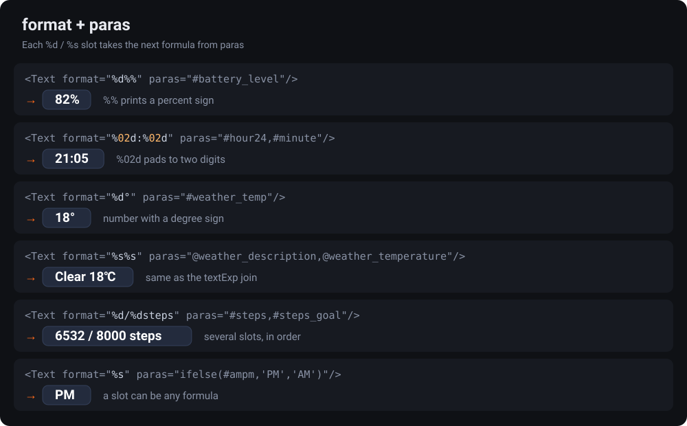
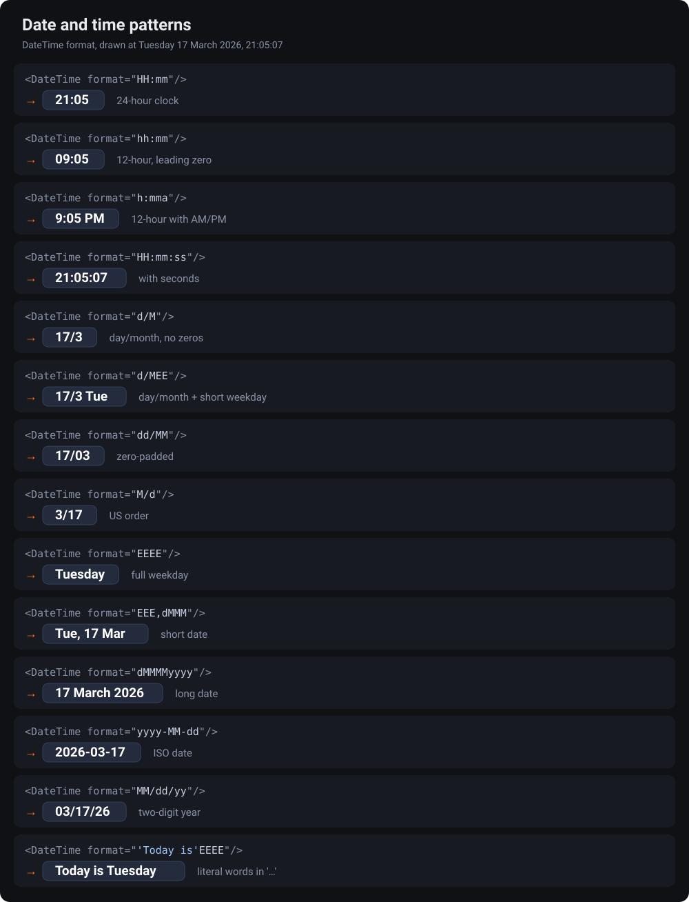

# Text, dates and times

[← Guide](README.md)

There are two elements for words on the screen:

- **`<Text>`**: any text, fixed or worked out from a formula.
- **`<DateTime>`**: the date and/or time, written with a pattern such as `HH:mm` or `d/M EE`.

(Clocks made of digit pictures, `<Time>` and `<ImageNumber>`, are covered in [Position, size and style](layout.md#digit-picture-clocks).)

## Three ways to give a Text its words

| Attribute | Use it for | Example | Shows |
| --- | --- | --- | --- |
| `text` | Fixed words | `text="Swipe up to unlock"` | Swipe up to unlock |
| `textExp` | A formula | `textExp="@weather_description+' '+@weather_temperature"` | Clear 18℃ |
| `format` + `paras` | A template with slots | `format="%d%%" paras="#battery_level"` | 82% |

If a Text has more than one, **`textExp` wins, then `format`, then `text`**.

### textExp: a formula

`textExp` is a formula whose result is the text. Variables, quoted words and `+` are all you need for most things:

```xml
<Text x="540" y="790" align="center" size="46" color="#ccffffff"
      textExp="@weather_description+' '+@weather_temperature"/>
```

→ **Clear 18℃**

- `@weather_description` is the text `Clear`, `@weather_temperature` is `18℃`.
- `' '` is a quoted space. Single quotes inside the attribute, double quotes around it.
- `+` joins them. When either side is text, `+` joins; when both are numbers, it adds.

More formulas, with results, in [Formulas](expressions.md#joining-text).

### format + paras: a template

`format` is a template with slots; `paras` lists one formula per slot, separated by commas, in order.



| format | paras | Shows | Why |
| --- | --- | --- | --- |
| `%d%%` | `#battery_level` | 82% | `%%` prints a percent sign |
| `%02d:%02d` | `#hour24,#minute` | 21:05 | `%02d` pads to two digits |
| `%d°` | `#weather_temp` | 18° | number with a degree sign |
| `%s %s` | `@weather_description,@weather_temperature` | Clear 18℃ | same as the textExp join |
| `%d / %d steps` | `#steps,#steps_goal` | 6532 / 8000 steps | several slots, in order |
| `%s` | `ifelse(#ampm,'PM','AM')` | PM | a slot can be any formula |

Slots:

| Slot | Prints |
| --- | --- |
| `%d` | a whole number (decimals are cut off) |
| `%02d` | a whole number padded with zeros to 2 digits (`%03d` → 3 digits) |
| `%s` | text (or a number as text) |
| `%f`, `%.1f` | a decimal number. The editor's preview prints the value as is; the phone rounds `%.1f` to one decimal |
| `%%` | a literal `%` |

`formatExp` is a formula that produces the template itself, for templates that change.

### Other Text settings

| Attribute | Meaning |
| --- | --- |
| `size` | Font size in px (of a 1080-wide screen). Default 18. |
| `color` | `#AARRGGBB`, see [colours](layout.md#colours) and [colour formulas](layout.md#colour-formulas). |
| `bold="true"` | Bold. |
| `fontFamily` | A font name, e.g. `mipro-medium`, `mipro-light`, `miclock-thin`. The weight in the name is used by the preview. |
| `align`, `alignV` | Which point of the text sits on `x`/`y`, see [alignment](layout.md#x-y-and-alignment). |
| `w` + `multiLine="true"` | Wrap long text inside width `w`. |
| `marqueeSpeed` | With `w`, scroll text that doesn't fit (phone only; the preview shows it still). |
| `spacing` | Extra space between letters. |
| `shadowColor`, `shadowDx`, `shadowDy`, `shadowRadius` | A text shadow. |

## Date and time patterns

`<DateTime format="…"/>` shows the phone's current date and time with a pattern. Letters stand for parts of the date; repeat a letter for a longer form. Anything in single quotes is printed as is.



### Ready-made patterns

All at Tuesday 17 March 2026, 21:05:07:

| format | Shows | |
| --- | --- | --- |
| `HH:mm` | 21:05 | 24-hour clock |
| `hh:mm` | 09:05 | 12-hour, leading zero |
| `h:mm a` | 9:05 PM | 12-hour with AM/PM |
| `HH:mm:ss` | 21:05:07 | with seconds |
| `d/M` | 17/3 | day/month, no zeros |
| `d/M EE` | 17/3 Tue | day/month + short weekday |
| `dd/MM` | 17/03 | zero-padded |
| `M/d` | 3/17 | US order |
| `EEEE` | Tuesday | full weekday |
| `EEE, d MMM` | Tue, 17 Mar | short date |
| `d MMMM yyyy` | 17 March 2026 | long date |
| `yyyy-MM-dd` | 2026-03-17 | ISO date |
| `MM/dd/yy` | 03/17/26 | two-digit year |
| `'Today is' EEEE` | Today is Tuesday | literal words in '…' |

### Every letter

| Letter | Part | 1 letter | 2 letters | 3 letters | 4+ letters |
| --- | --- | --- | --- | --- | --- |
| `y` | year | 2026 | 26 | 2026 | 2026 |
| `M` | month | 3 | 03 | Mar | March |
| `d` | day of month | 17 (on the 7th: 7) | 17 (on the 7th: 07) | | |
| `E` | weekday | Tue | Tue | Tue | Tuesday |
| `H` | hour 0–23 | 9 | 09 | | |
| `k` | hour (the preview treats it like `H`) | | | | |
| `h` | hour 1–12 | 9 | 09 | | |
| `m` | minute | 5 | 05 | | |
| `s` | second | 7 | 07 | | |
| `a` | AM / PM | PM | | | |
| `'…'` | literal text | | | | |

Anything that isn't a letter (`/ : - , .` and spaces) is printed as is. To print a letter as a word, quote it: `'at' HH:mm`.

Weekday and month names are in the phone's language: on a phone set to French, `EEEE` prints *mardi*. The editor's preview always uses English.

The Chinese lunar calendar letters some Chinese themes use (`N`, `e`) are drawn on the phone but left empty in the preview.

### 12 or 24 hours, following the phone

The phone tells layouts which the user picked with `#time_format` (1 = 24-hour, 0 = 12-hour). Pick the pattern with `formatExp`:

```xml
<DateTime x="540" y="420" align="center" size="230"
          formatExp="ifelse(#time_format,'HH:mm','h:mm')"/>
```

### A date inside a formula

`formatDate(pattern, time)` returns the same text as a `DateTime`, so dates can be joined with other things in a `textExp`:

| textExp | Shows |
| --- | --- |
| `formatDate('EEEE',#time)` | Tuesday |
| `formatDate('d/M EE',#time)+'  '+@weather_temperature` | 17/3 Tue  18℃ |

`#time` is now. Another moment can be shown with `value` on a `DateTime` (milliseconds since 1970), for example `value="#time+86400000"` for tomorrow.

### Building a time from numbers

The phone also gives the parts of the time as numbers (`#hour24`, `#hour12`, `#minute`, `#date`…, see [Variables](variables.md)), handy for one big digit each or for arithmetic:

| textExp | Shows |
| --- | --- |
| `ifelse(#minute{10,'0'+#minute,#minute)` | 05 |
| `#hour12+':'+ifelse(#minute{10,'0','')+#minute+ifelse(#ampm,' PM',' AM')` | 9:05 PM |

Usually `DateTime` (or `format="%02d" paras="#minute"`) is simpler.

Next: [Formulas →](expressions.md)
